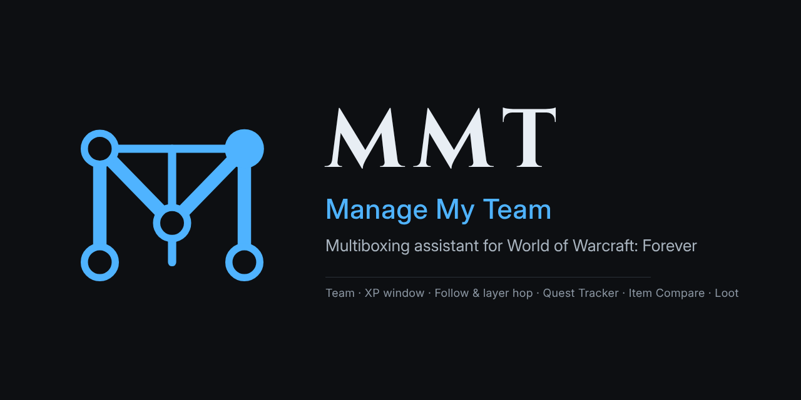

  

# MMT - Manage My Team

A lean multiboxing assistant for World of Warcraft: Forever (interface 16001).
Version 0.8.5: core addon (MMT) plus optional modules (MMT_*).
To install, download the repository (Code > Download ZIP) and copy the four `MMT*` folders.

## Install
Copy the `MMT` folder and the module folders you want (e.g. `MMT_ItemCompare`) into
`World of Warcraft/_classic_beta_/Interface/AddOns/`.
Install them on **every** account/client you multibox with.
If you used OMT: keep it enabled for the first login with MMT (its settings are
copied into the "Default" profile), then disable or delete OMT.
Saved data from MMT 0.1.x is converted automatically.

## Core and modules
- **Core** (`MMT`, always on): Team, Roles, XP Window, Automations, Profiles, plus team
  communication, profile sync and debug tools.
- **Modules** (`MMT_<Name>`, optional): separate addons that build on the core. They
  appear in the game's AddOns list and under MODULES in /mmt, where switched-off
  modules are greyed out. Switching one off in /mmt stops it right away and disables
  it for the next login; switching one on starts it right away, or after a reload if
  it wasn't loaded. "Manage modules" lists all installed modules with version, author and
  repository link (TOC fields `## Version`, `## Author`, `## X-Repository`; click the link
  to copy it). When a switch needs a UI reload, a "Reload UI" bar appears at the bottom.
- Modules so far: **Item Compare** (`MMT_ItemCompare`), **Loot Distribution** (`MMT_LootDistribution`),
  **Quest Tracker** (`MMT_QuestTracker`).
- Settings sync for modules: add `sync = true` to `MMT.NewModule{...}` and the module gets
  a "Sync to team" button in the bottom right of its settings page and `/mmt sync <name>`.
  Only `M.db` is sent (never `M.store`). Optional: `syncExclude = { "key", ... }` for
  settings that stay on each client, `M.OnSyncReceived(m, from)` after settings arrived,
  `M:SyncToTeam()` and `M:SyncButton(frame)` for windows of your own. Example on /mmt > Help.
- A new module folder needs a full game restart (not just /reload) before the game lists it.

## Settings (/mmt)
- **Team**: Add group / Add me / Add target, or type "First Last". Reorder with Up/Dn.
- **Roles**: create roles, tick their members, add items (drop one on the slot, or
  click the field and shift-click an item anywhere; IDs and exact names work too),
  rules (all grey, all Bind on Equip, by quality) and item groups (Cloth, Leather,
  Herbs, Ore/bars/stone, Enchanting, Potions, Food & drink, Reagents, Consumables, ...).
  Opening a trade with a team member puts the matching items in. You accept yourself.
- **XP Window**: XP %, rested XP %, gold, free bag slots, durability (lowest item or
  average), plus font, layout, size, scale and opacity. Gold, bags and durability sit in
  their own column left of the name; the bar starts at the name. "Bar shows": experience
  or the reputation of each character's watched faction (standing and %, faction in
  the tooltip). "Layer Hop": when the game
  offers a layer/phase switch, a pulsing red "Layer Hop" appears left of the name.
  Click it to accept in 3 seconds (a teammate's tag makes their client accept), or let
  MMT accept automatically after X seconds. Both count down in chat. Hover a row for all details of that member,
  Mouse on a member: click invites, right-click inspects, Ctrl-click shows the talents,
  Ctrl-right-click removes from the group (on yourself: character pane, talents, leave
  group). Shift + drag moves the window, Shift-right-click opens the settings.
  "Click-through" turns the mouse off for it. During a layer hop countdown every
  client's XP window shows "Layer Hop 5, 4, ...".
  "Follow": every client reports when its character starts or stops following (/follow).
  A member who stops gets a red row that pulses for 10 seconds, then "(no follow)" in red
  after the name until they follow again; the client of the character that was
  followed shows the raid warning "<Name> stopped following" and plays the raid warning
  sound. Options: check /follow of team, warning, sound, ignore breaks during combat
  (then it only counts if the character still isn't following some seconds after its
  combat; default 5, adjustable).
  Flight paths don't count as a break.
- **Item Compare** (module): set a key, hover an item and press it to see what every team
  member wears in that slot (both slots for rings, trinkets and one-hand weapons),
  with the stat and item level changes if they equipped the hovered item.
- **Loot Distribution** (module): sets Free for All, Round Robin or Master Looter and the
  loot threshold when a group forms or a team character becomes leader. As master
  looter it gives items at or above the threshold to the team member whose roles want
  them: first in team order with more free bag slots than the reserve. Bind on Pickup
  items are never given out: they are posted in group chat for manual assignment.
  "Auto-Round Robin quest items": quest items go to the team in turns (team order).
  The master looter first asks the team who still needs the item (each client checks
  its quest log) and skips characters whose objective is complete. If the game still
  refuses a hand-out, that character is skipped for that item for 10 minutes.
- **Quest Tracker** (module): replaces the Blizzard quest tracker with a team tracker:
  Zone > [Level] Quest > Objective > one row per team member with their progress
  ("3/8", "done", "not on quest"). Mouse:
  - +/- at the start of a line: collapse / expand it; [-] / [+] on the header: collapse
    everything down to the zones / open everything.
  - Shift + drag: move the tracker (unless locked). Right-click: settings.
  - Quest: click opens it in the quest log, Shift-click links it in chat,
    Shift-right-click abandons it (asks first).
  - Zone: Ctrl-click collapses / expands all its quests (only the quest names),
    Ctrl-right-click shows only that zone (again: all zones). The quest log's tracked
    quests aren't changed by this.
  Background colour and opacity, width, maximum height (scrolls beyond), indent,
  alignment, outline, and font, size and colour for each of the four levels.
  Quest automation lives here too: accept from NPCs and from the group, turn in, skip
  grey quests, announce "ready for turn-in", share new quests automatically, announce
  quests that can't be shared, and abandon a quest on the whole team (asks first:
  "Do you want to abort this quest on your entire team?"). The quest settings of
  Core > Automations are copied over once.
- **Automations**: gossip to vendor, click through dialog-only NPCs (plain dialog lines;
  anything that could cost gold, teleport, train or start a fight stays manual), sell greys, repair, role-based trades, invites (team, friends,
  guild, and anyone who whispers the keyword, default "mybox"), camera zoom,
  distance window.
- **Shift**: hold it while an NPC window opens to keep that page manual; pick an option
  without Shift and the next page (dialog, quest, reward) is automated again.
- **Profiles**: per character; copy, reset, delete, export/import.
- **Sync to team**: `/mmt sync` (or the blue button in the bottom right of Profiles) sends
  the core settings of the active profile: team, roles, XP window incl. its position,
  automations, distance window. Module settings are not included. Item Compare, Loot
  Distribution and Quest Tracker have their own button and `/mmt sync <module>`
  (e.g. `/mmt sync questtracker`), which sends only that module's settings.
  Messages are paced to stay under the game's addon message limit. The sender sees who
  it went to and who confirmed (received, accepted, declined); recipients see when a
  transfer starts and when it is complete, then a dialog to accept it.
- **Help**: debug tools with a how-to, and guides for writing modules and using the
  team communication (with copyable example code).

The settings window has its own scale (- / + at the bottom left, right-click resets,
or `/mmt scale 130`), kept per account. The XP window's scale is under XP Window > Look.

Windows show first names only; hover a name for the full name and details.
Chat messages and the debug report use full names.

## Layer and phasing
- Layer (zoneUID of nearby NPCs) and phasing (`UnitPhaseReason`) are still shown in the
  XP window's mouseover details and in the debug report:
  0 Phased, 1 Sharded, 2 War Mode, 3 Chromie Time, 4 Timerunning, 5 Ruleset.
- Layer hops ("World refresh in N minutes", event SHARD_TRANSFER_IMMINENT) are accepted
  with `C_PlayerInteractionManager.ShardTransferConfirm()`.
  "Sharded" on the same layer: cross a zone border together, re-invite from the
  character whose shard you want to keep, or meet in a capital city.

## Item Compare data
Each client stores the team's equipped items (account-wide, so offline members are
shown with the age of their data). Only item strings are sent, never tooltips:
the core heartbeat carries a hash of your gear, a member with an outdated copy asks
once for a snapshot, and gear changes send only the changed slots.
The key can also be set in Esc > Options > Keybindings > AddOns > MMT.

## Quest Tracker data
Every client keeps the team's quest logs (quest ID, level, zone, title, objective
progress). The heartbeat carries a hash (qt=), an outdated copy is requested once
(QTREQ, answered in chunks QTS), and changes send only the changed quests (QTD).
Team abandon is QTAB:<questID>.

## Commands
- `/mmt` settings, `/mmt xp` toggle XP window, `/mmt trade` refill open trade,
  `/mmt sync` send the core settings to the team, `/mmt sync <module>` only that module's settings, `/mmt modules` installed
  modules, `/mmt scale <percent>` settings window size, `/mmt help` help page, `/mmt reset` reset profile.

## Team communication
- All messages go through one send queue in the core with three priorities (alerts such
  as follow and layer hop first, then normal messages, large transfers last). It keeps to
  the game's limit of about 10 messages per addon prefix and then 1 per second on group
  and guild channels, caps the data rate (800 bytes/s; Team > "Faster sending": 1200) and
  sends throttled messages again.
- Large transfers (settings sync, Item Compare and Quest Tracker snapshots) use their own
  prefix "MMTB", so they never delay the normal messages, and outside instances they go
  by whisper to each team member (whispers aren't throttled there).
- Team > "Use guild channel": one message on the guild channel reaches every team member
  in your guild, grouped or not; the guild roster tells who is online. Members outside the
  guild still get whispers. Every client needs the same setting.
- Modules: `MMT.SendToTeam(msg, onlyOnline, prio)`, `MMT.SendAddon(msg, channel, target, prio)`,
  `MMT.SendLong(text[, target])` for texts of any size (Help > Team communication).
- All clients need MMT 0.8.4 or later for large transfers (older versions don't listen
  on "MMTB").

## Two accounts = two separate teams
Every account keeps its own saved settings, so the team must exist on each client:
group up and press *Add group* on every client, or add the team once and send it
with `/mmt sync` (accept the popup on the others).

## Debugging (also on /mmt > Help)
1. `/mmt debug` switches the debug log on (again to switch off).
2. `/mmt debug clear`, then add your characters, run `/mmt ping` and open a trade.
3. `/mmt debug dump` opens a report (names, group, layer, phase reasons, team, trade,
   log). *Select all*, Ctrl+C, paste it to Claude.
- `/mmt ping` whispers every team member with three spellings of the name.
- `/mmt debug name First Last` shows how a typed name is understood.
- `/mmt debug talents` lists what the game offers to view talents (XP window Ctrl-click).
- `/mmt debug chat` prints the log lines live into chat.

## Logo
The MMT logo is in [`media/`](media): profile images (`mmt-logo.png` dark, `mmt-logo-light.png` light,
512×512), the GitHub social preview (`mmt-banner.png`, 1280×640) and the mark as SVG
(`mmt-mark.svg`). In the game it shows in the settings window and the AddOns list
(`MMT/Media`).

## License
GNU General Public License v3.0, see [LICENSE](LICENSE).
